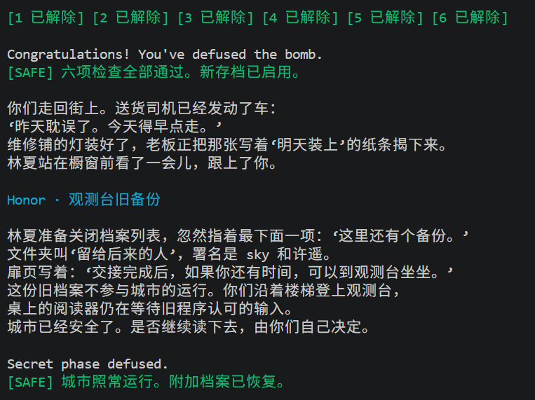

# BombLab 实验报告

---

## 1. 第 1 关：函数调用链（`phase_01` / `p1_compute`）

### 关键汇编

```asm
p1_step2:  lea (%rdi,%rsi,8),%eax ; xor $0x46f4,%eax   ; (a + 8*b) ^ 0x46f4
p1_step0:  xor $0x9049,%esi       ; lea (%rsi,%rdi,2),%eax ; (b ^ 0x9049) + 2*a
p1_step1:  lea (%rdi,%rdi,2),%eax ; add $0x7460,%esi ; xor %esi,%eax ; (3*a) ^ (b + 0x7460)

p1_compute:
  mov %edi,%esi          ; esi = low32
  shr $0x20,%rax         ; rax = high32
  shr $0x10,%rdx         ; rdx = challenge >> 16
  call p1_step2(high, low)
  call p1_step0(low, (challenge>>16))
  call p1_step1(step0, step2)
```

`phase_01` 用 `sscanf("%u", &v)` 读一个整数，与 `p1_compute(challenge)` 比较。

### 恢复出的计算关系

```c
uint32_t low  = (uint32_t)challenge;
uint32_t high = (uint32_t)(challenge >> 32);
uint32_t mid  = (uint32_t)(challenge >> 16);
uint32_t s2 = (high + 8*low) ^ 0x46f4;
uint32_t s0 = (mid ^ 0x9049) + 2*low;
answer = (3*s0) ^ (s2 + 0x7460);   // 1 个整数
```

### 推理

`p1_compute` 把 64 位 challenge 拆成 low/high/位移 16 三份，依次调用三个无副作用的 helper，最终用一个整数作为口令。对照三个 helper 的 `lea`（乘 2、乘 3、乘 8）与 `xor` 立即数，即可写出上面的纯 `uint32_t` 运算式。

---

## 2. 第 2 关：数组与递推（`phase_02`）

### 关键汇编

```asm
  valid_u32_fields(input, 6)          ; 共 6 个整数
  sscanf("%u %u %u %u %u %u", &a[0..5])

  mov  %r13,%rax ; shr $0x1e,%rax ; movzbl %al,%eax
  lea  (%rax,%rax,2),%eax            ; a[0] == 3 * ((challenge>>30) & 0xff)

  mov  $0xd,%ecx    ; 初始移位 13
  mov  $0x1,%edx    ; i = 1
loop:
  shr  %cl,%rax ; and $0x3f,%eax      ; (challenge >> shift) & 0x3f
  add  %edx,%eax                       ; + i
  xor  %esi,%eax                       ; ^ a[i-1]
  lea  (%rax,%rax,4),%eax              ; * 5
  ; a[i] == 5 * (((challenge>>shift)&0x3f) + i) ^ a[i-1]
  add  $0x1,%edx ; add $0x5,%ecx ; cmp $0x6,%edx
```

### 恢复出的计算关系

```c
a[0] = 3 * ((challenge >> 30) & 0xff);
for (i = 1; i < 6; ++i)
    a[i] = 5 * ((((challenge >> (8 + 5*i)) & 0x3f) + i) ^ a[i-1]);
```

### 推理

`valid_u32_fields(input, 6)` 里的 `esi=6` 直接说明口令由 6 个整数组成。第一个数由 challenge 的 bit30..37 决定；其后 5 个数是递推关系：移位从 13 开始每次 +5，取低 6 位加下标，再与上一项异或后乘 5。

---

## 3. 第 3 关：switch 跳转表（`phase_03` / `p3_dispatch`）

### 关键汇编

```asm
  sscanf("%u %u", &v0, &v1)
  mov %r12d,%edi ; and $0x7,%edi      ; index = challenge & 7  == v0
  shr $0x3,%rax                        ; (challenge >> 3)
  shr $0x20,%rsi                       ; (challenge >> 32)
  xor %eax,%esi                        ; value = (c>>3) ^ (c>>32)
  call p3_dispatch(index, value)       ; v1 == 返回值
```

`p3_dispatch` 先做范围检查（`cmp $0x7,%eax; ja`），再通过 `jmp *0x405820(,%rax,8)` 跳转。跳转表（位于 `.rodata`）索引到 8 个 `case`：

| index | case | 计算 |
| --- | --- | --- |
| 0 | case_1 | `5*v + 0x2491` |
| 1 | case_4 | `5*v + 0x4fee` |
| 2 | case_5 | `5*v + 0x14fdc` |
| 3 | case_2 | `5*v + 0x32f4b` |
| 4 | case_0 | `(2*v) ^ 0x4710` |
| 5 | case_3 | `(v ^ 0xfbd5) + (v >> 2)` |
| 6 | case_7 | `(v ^ 0x11f) + (v >> 2)` |
| 7 | case_6 | `(2*v) ^ 0xe630` |

### 恢复出的计算关系

```c
index = (uint32_t)challenge & 7;
value = (uint32_t)(challenge >> 3) ^ (uint32_t)(challenge >> 32);
answer = [ index, dispatch(index, value) ];   // 2 个整数
```

### 推理

`sscanf` 后先比较 `challenge & 7` 与第一个输入，确定「跳转表下标」；再用跳转表下标与 `value = (c>>3) ^ (c>>32)` 查出第二项。跳转表是 8 个 8 字节指针，`objdump -s` 读出各 `case` 的地址后反查 `case_x` 的 `lea`/`xor` 得到上表。

---

## 4. 第 4 关：递归二分查找（`phase_04` / `p4_walk`）

### 关键汇编

```asm
p4_walk(target, low, high, salt):
  mov %edx,%edi ; sub %esi,%edi ; shr $1,%edi ; add %esi,%edi   ; mid = low + (high-low)/2
  cmp %eax,%edi ; je base                                    ; target == mid
  lea (%rdi,%rcx,1),%ebx                                     ; mid + salt
  ; target < mid -> 左子树, 返回 ((5*ret) ^ (mid+salt)) ^ 0x0a
  ; target > mid -> 右子树, 返回 ((5*ret) ^ (mid+salt)) ^ 0x11
base:
  lea 0x6e(%rdi),%eax ; xor %ecx,%eax                        ; (mid + 0x6e) ^ salt
```

`phase_04`：`target = challenge & 0x7f`，`salt = (challenge>>7) ^ (challenge>>32)`，`low=0, high=0x7f`。

### 恢复出的计算关系

```c
uint32_t p4_walk(uint32_t target, uint32_t low, uint32_t high, uint32_t salt) {
    uint32_t mid = low + ((high - low) >> 1);
    if (target == mid) return (mid + 0x6e) ^ salt;
    if (target < mid)
        return ((5*p4_walk(target, low, mid-1, salt)) ^ (mid+salt)) ^ 0x0a;
    return ((5*p4_walk(target, mid+1, high, salt)) ^ (mid+salt)) ^ 0x11;
}
answer = p4_walk(challenge & 0x7f, 0, 0x7f, (challenge>>7) ^ (challenge>>32)); // 1 个整数
```

### 推理

`p4_walk` 的四条递归返回路径非常规整：基例 `(mid+0x6e)^salt`，左右子树各自 `5*ret` 后异或 `(mid+salt)` 再异或一个 0x0a / 0x11 的常数。`target` 被 `and $0x7f` 限定在 [0,127]，而搜索区间恰是 [0,127]，因此必然命中基例。

---

## 5. 第 5 关：结构体与链表遍历（`phase_05` / `p5_traverse`）

### 关键汇编

```asm
p5_traverse:
  mov %rdi,%rax ; and $0x7,%eax          ; index = challenge & 7
  mov 0x405b60(,%rax,8),%rdx             ; node = index_table[index]
  mov 0x8(%rdx),%esi                     ; node->tag   (偏移 8)
  shr $0x6,%rax ; shr $0x20,%rdi
  xor %edi,%eax ; xor 0xc(%rdx),%eax     ; fold = (c>>6)^(c>>32)^node->value
  xor $0x91c6,%eax
  mov %esi,(%r8) ; add %esi,%eax         ; fold += node->tag, 记下 tag
  and $0x3,%edi ; mov %edi -> steps      ; steps = (challenge>>3) & 3
  ; 循环 steps 次: node = node->next; fold ^= node->value; fold += node->tag; 记下 tag
```

### 数据结构（`.rodata` 中读出的表）

节点结构：`next`（8 字节指针，偏移 0）、`tag`（偏移 8）、`value`（偏移 12）。索引表 8 项指向 8 个起始节点，链表整体有 12 个节点。逐节点读出如下（`next` 用节点编号表示，-1 为 NULL）：

| id | next | tag | value | | id | next | tag | value |
| --- | --- | --- | --- | --- | --- | --- | --- | --- |
| 0 | 1 | 0x34e | 0xe64d | | 6 | 4 | 0x954 | 0x212a |
| 1 | 9 | 0x03d | 0xa96d | | 7 | 3 | 0x86d | 0xdbe7 |
| 2 | 8 | 0x62e | 0x666b | | 8 | 0 | 0x20b | 0x19b6 |
| 3 | 10 | 0x56a | 0x1146 | | 9 | 5 | 0xa15 | 0x6521 |
| 4 | 7 | 0x451 | 0xc651 | | 10 | 2 | 0x128 | 0xc7ce |
| 5 | 11 | 0x726 | 0x7be4 | | 11 | -1 | 0xb46 | 0x2d05 |

索引表 `index_table[8] = {6, 4, 7, 3, 10, 2, 8, 0}`。

### 恢复出的计算关系

```c
node = index_table[challenge & 7];
fold = (uint32_t)(challenge>>6) ^ (uint32_t)(challenge>>32) ^ node->value ^ 0x91c6;
fold += node->tag;                       // 起始节点
out_tag = node->tag;
for (i = 0; i < ((challenge>>3)&3); ++i) {
    node = node->next;
    fold ^= node->value; fold += node->tag;
    out_tag = node->tag;
}
answer = [ fold, out_tag ];              // 2 个整数
```

### 推理

`p5_traverse` 的 `mov 0x405b60(,%rax,8),%rdx` 是典型的「以 challenge 低 3 位为下标取链表头」，`0x8(%rdx)` / `0xc(%rdx)` 说明 `tag`/`value` 的偏移，`(%rdx)` 是 `next`。折叠量先取 `value`、再累加 `tag`，而「步数」由 `(challenge>>3)&3` 决定。第二个输出是遍历到的最后一个节点的 `tag`。

---

## 6. 第 6 关：函数指针表间接调用（`phase_06` / `p6_dispatch`）

### 关键汇编

```asm
p6_dispatch:
  shr $0x6,%rdi ; shr $0x20,%rax ; xor %eax,%edi   ; value = (c>>6) ^ (c>>32)
  and $0x38,%ebx                                     ; index2 = (c>>3) & 7
  and $0x7,%eax                                      ; index1 = c & 7
  call *0x405e00(,%rax,8)        ; op[index1](value)
  xor $0xf4bd,%eax
  call *0x405e00(%rbx)           ; op[index2](上一次结果)
  add $0x3fd7,%eax
```

函数指针表（`.rodata`）：`table[8] = {op_5, op_4, op_1, op_5, op_3, op_0, op_2, op_4}`，各 `op`：

| op | 计算 |
| --- | --- |
| op_0 | `ror32(v, 5)` |
| op_1 | `(v ^ 0xf5c9) + 8*v` |
| op_2 | `rol32(v, 5) ^ 0x4b58` |
| op_3 | `(v + 0x4dc3) ^ (v >> 3)` |
| op_4 | `(8*v + 0xc255) ^ (7*v)` |
| op_5 | `(v ^ (v >> 7)) + 0x14e5` |

### 恢复出的计算关系

```c
value = (uint32_t)(challenge>>6) ^ (uint32_t)(challenge>>32);
first  = table[challenge & 7](value) ^ 0xf4bd;
answer = table[(challenge>>3) & 7](first) + 0x3fd7;   // 1 个整数
```

### 推理

两次间接调用 `call *0x405e00(...)` 表明存在函数指针表。第一次以 `challenge&7` 为下标，输入 `value`；结果异或 0xf4bd 后作为第二次调用的输入；第二次下标来自 `challenge & 0x38`（即 `(challenge>>3)&7`），最终再加 0x3fd7。`objdump -s` 读出表地址，逐个反查 `op_x` 得到 6 个操作。

---

## 7. Honor：secret 关

### 入口流程

`secret_gate(input, challenge_7, context)` 先把输入 `strcpy` 到栈缓冲区，检查**偏移 32..35 的 4 字节必须等于 `"OPEN"`**（`cmpl $0x4e45504f,-0xb0(%rbp)`，小端即 "OPEN"），然后把 `OPEN` 之后的字符串交给 `secret_phase` 按 3 个整数解析。因此第七行的格式为：

```
32 个任意非空字节 + "OPEN" + " " + a + " " + b + " " + c
```

### `secret_phase` 关键汇编

```asm
  sscanf("%u %u %u", &a, &b, &c)
  mov %r13d,%ecx ; and $0x3,%ecx           ; k = context & 3, a == k
  imul $0x9a30,%ecx,%r9d
  ; esi = (challenge>>32) ^ challenge_low   = x
  ; r8d = (context>>32)  ^ context_low      = y
  ; r9d ^= (uint32_t)(context >> 16)
  call secret_mix(x ^ y)                    ; (rol32(v,3) + 0x9a30) ^ 0xebf3
  xor %r9d,%eax                             ; b = secret_mix(x^y) ^ r9d
  ; c = b ^ ((y + k + 0xebf3) + (x >> 3))
```

### 恢复出的计算关系

```c
k = (uint32_t)context & 3;
x = (uint32_t)challenge ^ (uint32_t)(challenge >> 32);
y = (uint32_t)context  ^ (uint32_t)(context >> 32);
a = k;
b = ((rol32(x^y,3) + 0x9a30) ^ 0xebf3) ^ ((k*0x9a30) ^ (uint32_t)(context>>16));
c = b ^ ((y + k + 0xebf3) + (x >> 3));
// 输出: "AAAA...(32 个)OPEN " + a + " " + b + " " + c
```

### 推理

`secret_mix` 是 `rol32(v,3)` 加常量再异或常量；`secret_phase` 把 challenge 与 context 各自高低 32 位折叠成 `x`、`y`，再用 `k = context&3` 作为第一个数，`x^y` 经 `secret_mix` 后与 `(k*0x9a30)^(context>>16)` 异或得第二个数，第三个数是第二个数与 `(y+k+0xebf3)+(x>>3)` 的异或。`context` 由前六关答案经 `transcript_context` 计算，驱动已把结果传入，求解器直接使用即可。

---

## 8. 非公开 seed 验证记录

公开 seed 列表是 `tests/public.json` 里的 10 个。以下用**公开列表之外**的 seed 验证（全部通过）：

| seed | 六关 | Honor |
| --- | --- | --- |
| 20261029 | `Phase 1..6 defused.` + `Congratulations!` | `Secret phase defused.` |
| 777 | 同上 | `Secret phase defused.` |
| 123456789 | 同上 | `Secret phase defused.` |

运行命令与输出（以 seed 20261029 为例）：

```text
$ ./defuser --seed 20261029 | ./bomb --seed 20261029
Phase 1 challenge: 0x1ad27693d04a0d2f
Phase 1 defused.
Phase 2 challenge: 0x9dfa919569802e0c
Phase 2 defused.
Phase 3 challenge: 0x800a9ac407779fcc
Phase 3 defused.
Phase 4 challenge: 0xc75a17cd7c745b40
Phase 4 defused.
Phase 5 challenge: 0x1e857b19b205738e
Phase 5 defused.
Phase 6 challenge: 0x9052ac07ff217f59
Phase 6 defused.
Congratulations! You've defused the bomb.

$ ( ./defuser --seed 20261029; ./defuser --secret --seed 20261029 ) | ./bomb --seed 20261029
Secret phase defused.
```

公开测试结果：

```text
$ python3 public_test.py
Public tests: 60/60
Secret public tests: 10/10
```

---

## 9. 运行结果截图

seed 20261029 的完整运行结果：六关全部解除，随后进入 Honor（观测台旧备份）并解除 Secret 关。



## 10. 引用与工具

- 工具：
  - `objdump -d --no-show-raw-insn bomb` 导出汇编；
  - `objdump -s --start-address=...` / `readelf -S` 读取 `.rodata` 中的跳转表、链表与函数指针表；
  - `gdb`（`disassemble`、`x/uw`、`p/x`）在线确认寄存器/内存取值；
  - claude code辅助理解项目结构和汇编代码。
